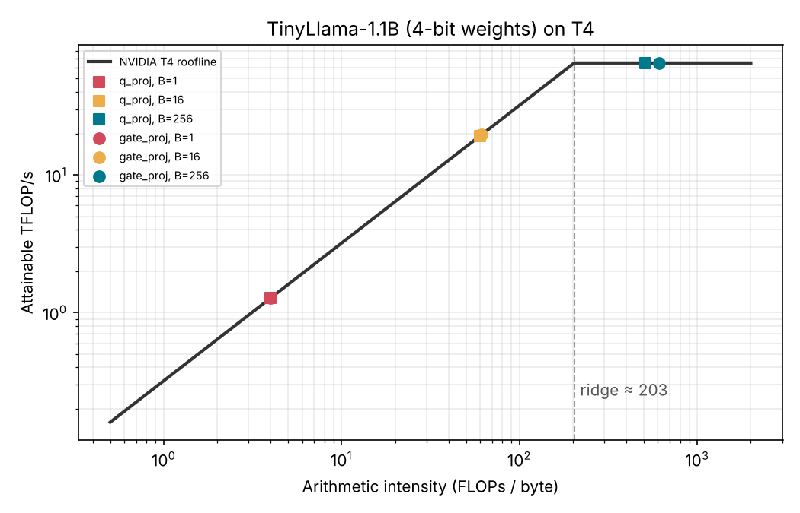

# LLM Inference Profiling → Systolic Accelerator

[](https://github.com/aaryan-gujarathi/llm-inference-profiling/actions/workflows/ci.yml)

Measure where a small LLM actually spends its time, then size custom hardware to the measurement instead of to folklore.

**Status:** Phase 1 ✅ · Phase 2 ✅ · Phase 3 🚧 (single PE verified; 8×8 array in progress)



## Key finding

At batch size 1, **every linear layer in TinyLlama-1.1B is memory-bound on a T4**, including the FFN, which is usually described as compute-bound.

For a layer $Y = XW$ with $W \in \mathbb{R}^{K \times N}$ and batch $B$:

$$
I = \frac{2BKN}{KN\,b_w + B(K+N)\,b_a} \;\xrightarrow{B=1,\;KN \gg K+N}\; \frac{2}{b_w}
$$

With 4-bit weights ($b_w = 0.5$ B), $I \approx 4$ FLOPs/byte. The T4 ridge point is $65\,\text{TFLOP/s} \,/\, 320\,\text{GB/s} \approx 203$. The matrix shape cancels out, so **batch size, not layer shape, decides which side of the roofline you're on.**

| Layer | K | N | I (FLOPs/B) | Bound |
| --- | ---: | ---: | ---: | --- |
| q_proj | 2048 | 2048 | 3.98 | memory |
| k_proj / v_proj | 2048 | 256 | 3.93 | memory |
| o_proj | 2048 | 2048 | 3.98 | memory |
| gate_proj / up_proj | 2048 | 5632 | 3.99 | memory |
| down_proj | 5632 | 2048 | 3.99 | memory |

Reproduce: `python -m analysis.intensity`

## Phases

| Phase | What | Where |
| --- | --- | --- |
| 1. Profile | TinyLlama-1.1B, 4-bit NF4 (`bitsandbytes`), `torch.profiler` on a Colab T4 | [`profiling/`](profiling/), [`notebooks/`](notebooks/) |
| 2. Paper design | 8×8 weight-stationary systolic tile sized to `gate_proj` (2048×5632); ~230 ns latency estimate | [`docs/design.md`](docs/design.md) |
| 3. RTL | SystemVerilog PE → 8×8 array → Verilator | [`rtl/`](rtl/), [`tb/`](tb/) |

## Repo layout

```
analysis/     roofline + arithmetic-intensity model (pure Python)
profiling/    GPU profiling script (needs CUDA)
notebooks/    original Colab notebook
rtl/          SystemVerilog sources
tb/           self-checking testbenches
tests/        pytest suite for analysis/
docs/         design notes, results, figures
```

## Quick start

```bash
pip install -r requirements.txt
make test      # pytest + RTL sim
make roofline  # regenerate docs/figures/roofline_t4.png
```

Profiling (GPU runtime, e.g. Colab T4):

```bash
pip install -r requirements-gpu.txt
python -m profiling.profile_tinyllama --tokens 32 --out results/
```

RTL sim only (needs [Icarus Verilog](https://github.com/steveicarus/iverilog) ≥ 11):

```bash
make sim
```

## Roadmap

- [x] Profile batch-1 decode, extract layer shapes
- [x] Roofline analysis
- [x] Paper design of 8×8 weight-stationary tile
- [x] PE RTL + self-checking testbench (1000+ random vectors, signed corners)
- [ ] 8×8 array with skewed activation input
- [ ] Verilator + cocotb testbench against a NumPy golden model
- [ ] Yosys synthesis for area/Fmax estimates

## License

MIT
